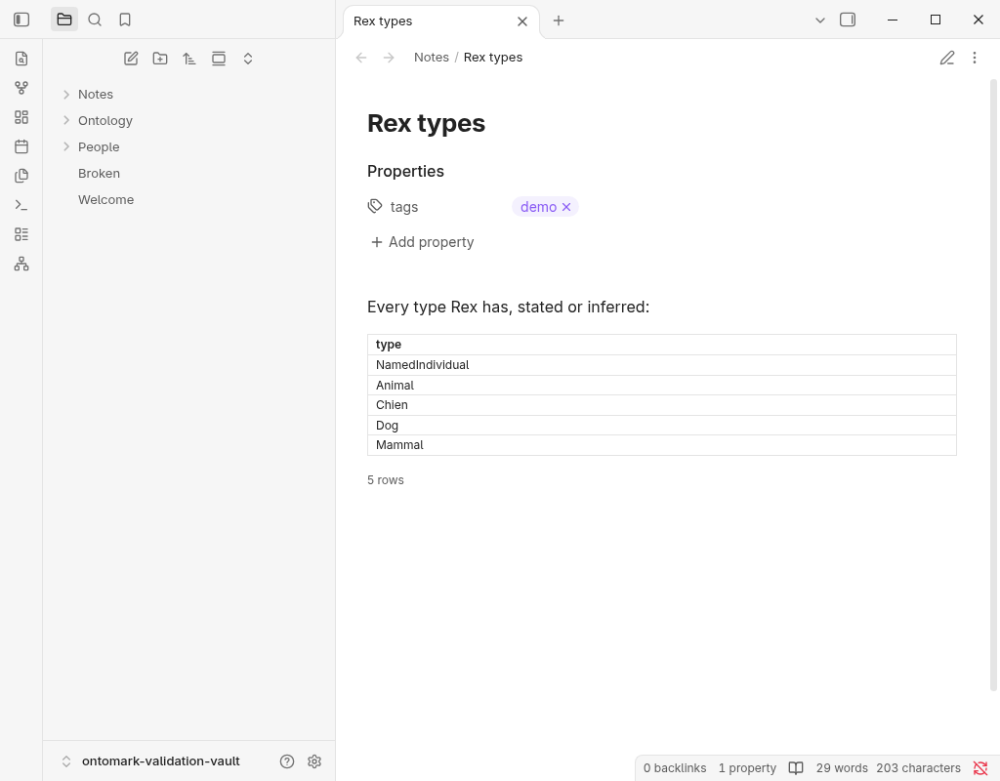
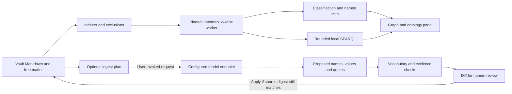
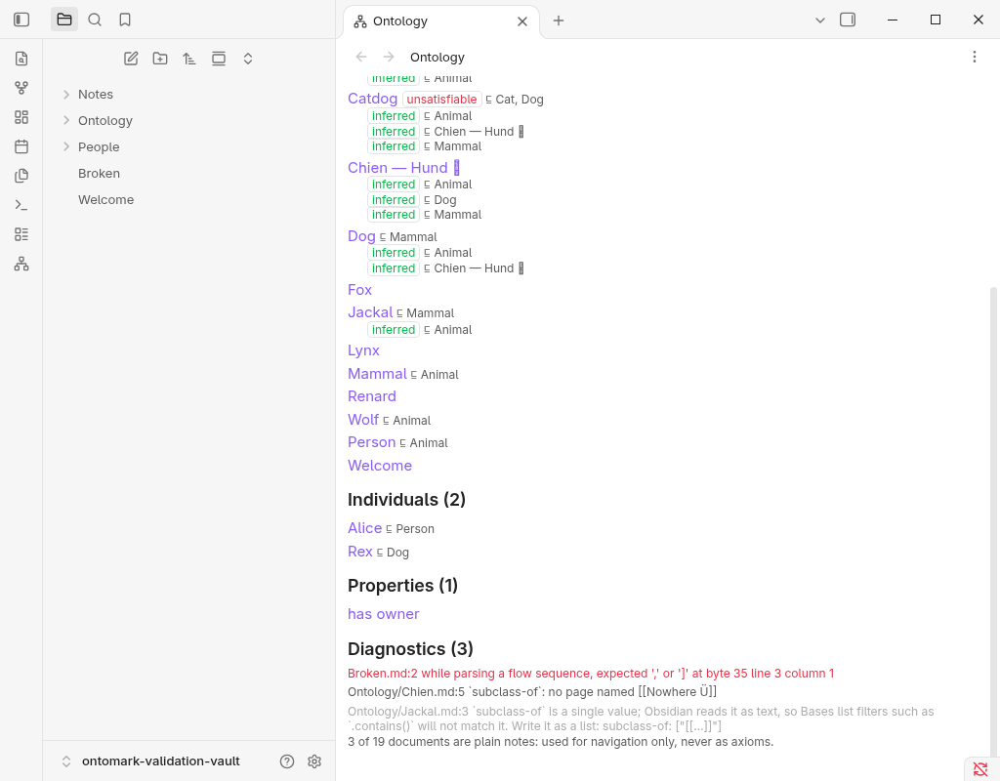

# Ontomark for Obsidian

[Install](#install) · [Try three notes](#three-notes-is-enough-to-start) · [Features](#what-you-get) · [Status](#working-status) · [Engine](https://github.com/DreamLab-AI/ontomark)

**Make your vault mean something to a machine, without changing how you write.** Add a `type` and a parent link to a note's frontmatter and Ontomark turns your vault into an ontology: it draws the hierarchy, works out what follows from it, answers precise questions about it, and shows every proposed change as a diff before anything is written. Notes stay plain Markdown. Nothing leaves your computer unless you choose to connect a model.

https://github.com/user-attachments/assets/5a129220-975a-4ac9-b501-d2b0365022cb

*Quick tour (2:09): graph, ontology panel, SPARQL queries and reviewed edits. [Open the video issue](https://github.com/DreamLab-AI/ontomark-obsidian/issues/1).*

## Why bother?

Backlinks tell you two notes are related. They cannot tell you *how*. An ontology can: Rex **is a** Dog, Dog **is a kind of** Animal, so Rex is an Animal, and anyone, human or agent, asking "which animals are in this vault?" gets Rex without you ever writing that down.

That matters most when a vault grows past what you can hold in your head, and when you start pointing AI tools at it. A model reading prose sees words that happen to sit together. A model reading a typed graph gets facts it can follow, check and cite. Ontomark gives your vault that layer, locally.

## Three notes is enough to start

`Animal.md`:

```markdown
---
type: class
---
```

`Dog.md`:

```markdown
---
type: class
subclass-of: ["[[Animal]]"]
---
```

`Rex.md`:

```markdown
---
type: individual
instance-of: ["[[Dog]]"]
---
```

Open **Ontology graph**. Solid edges are what you wrote; the dashed `Rex → Animal` edge is what the reasoner worked out. No folder layout, no special syntax beyond three frontmatter keys.

## What you get

| | |
| --- | --- |
| **Ontology graph** | Explore typed notes and their hierarchy. Search, zoom, focus a neighbourhood, open the note. Inferred edges are dashed. |
| **Ontology panel** | Browse classes, individuals and properties; see stated and inferred parents, and anything the reasoner could not handle. |
| **Local reasoning** | An OWL 2 EL reasoner runs inside Obsidian and keeps up as you edit. Unsupported constructs are reported and can make classification incomplete. |
| **SPARQL** | Ask structured questions (SELECT, ASK, CONSTRUCT) over what you stated, what was inferred, or both. A working example is loaded for you. |
| **SPARQL in a note** | Put a query in an `ontomark-sparql` code block and it renders its result there, live. `__THIS__` is the note it sits in and `[[Note]]` is any entity note; `# dataset: combined` includes what was inferred. After [Dot Triples](https://github.com/cristianvasquez/dot-triples-plugin). |
| **Reviewed edits** | Commands to make a note a class, individual or property, or add a parent. Every change is a diff you apply, and is refused if the file changed underneath it. |
| **Assisted ingest** | Point the plugin at a model endpoint of your choosing, enter a key for the session, and run *Extract facts from this note*. The model suggests; the engine checks every suggestion against your vault and the note's own text; you see a diff with each quote beside its fact, and the refusals with their reasons, and decide. Off by default: nothing is sent until you set an endpoint, and requests are made only when you run the command. The transport’s redirect limitation is described below. |


<sup>Every count in the drawing comes from one six-note example vault (`docs/figures/anatomy-src/model.mjs`); the build fails if the drawing stops matching it. Ingest is drawn switched on; it is off by default and does nothing until you set an endpoint. The figure follows your system's light or dark setting.</sup>

### About assisted ingest

Language models are good at reading a note and bad at being trusted with your ontology: they invent identifiers, merge things that share a name, and quote text that is not there. Ontomark's ingest lets the model do only the reading.

- The model receives the note's text, its label and the keys it may fill. Other notes and the vault path are excluded from the model payload. A configured session key is sent to the endpoint as an HTTP authorisation header, not as prompt text.
- The engine grounds every proposed **name** against the labels and aliases already in your vault; the model's own identifiers are ignored. A name that fits two notes is withheld as ambiguous, not guessed.
- Every value needs a verbatim quote from the note, and the quote has to mention the value. Literals are checked against their types (`3,5` is not a decimal; `2023-02-29` is not a date).
- Everything accepted becomes **one** patch, shown as the usual diff with the evidence highlighted. Everything refused is listed with the reason. Apply is the normal reviewed-edit path; undo is Obsidian's undo.

Ingest uses the configured absolute HTTP(S) URL and sends a configured key in an authorisation header. Use an endpoint you trust to handle the note text and credentials. Obsidian's `requestUrl` can follow redirects without exposing the final URL, so the plugin cannot guarantee that the configured host is the only destination. It rejects a 3xx status if one is returned to it; that does not prevent a redirect already followed by the host layer. Redirect behaviour has not received installed-desktop acceptance. See [`ingest-transport.ts`](src/ingest-transport.ts) and [ADR-OBS-003](docs/adr/ADR-OBS-003-ingest-action-and-offline-contract.md).

### Jev option (optional, off by default)

> Proposed research candidates. The wiring and its fallback tests show the option is safe to switch on, not that it helps; none of the three has been evaluated against its baseline.

Jev is TypeSafe's typed-decision model (`POST /v1/systemone`: Choice, Score, Noul). The option adds three opt-in helpers beside the existing ones. **Everything below is off until you turn on *Use Jev typed decisions* in settings *and* type an endpoint.** With it off, no request is built, nothing leaves your machine, and the plugin behaves exactly as before; the commands and the query row below are not even shown.

**What leaves, and where.** Only to the endpoint you type (the full `/v1/systemone` URL; there is no default address and nothing is read from the environment), only when you use one of these actions, and only this:

| Action | Item | What is sent |
|---|---|---|
| *Extract facts from this note*, after the engine has grounded the model's answer | OB-01-S1-01 semantic verifier | The note's title, and for each accepted fact its key, the value as it would be written, and the verbatim quote the engine located. Not the rest of the note. |
| *Suggest query (Jev)* in the SPARQL panel | OB-02-S1-01 query template picker | Your question, the labels and kinds of vault entities it mentions, and the names of the fixed query templates. |
| *Propose a frontmatter edit from a sentence (Jev)* | OB-03-S1-01 edit proposal | Your sentence, the note's title and current type, and the labels and kinds of entities it mentions. |

Notes are private by default, so the toggle's own text repeats this, and the API key is held in memory only (never in `data.json`) and may be empty for a keyless local endpoint. Prefer a local decision model; use a hosted endpoint only for notes you would send there anyway.

**Authority stays with the engine and with you.** Jev only chooses or checks; it never writes, signs or approves.

- *Verifier.* A fact Jev doubts gets a visible warning in the review dialog. It is dropped only if you set *Withhold facts Jev rates at or below* above 0 (default 0: never), and then the engine's own `ingest_accept` is run again on the surviving proposals, so quote grounding, vocabulary grounding, kind and conflict checks, the source-digest guard and the diff you must Apply all still decide the patch. If the re-run would write anything the plain run did not, the plain result is kept.
- *Query picker.* Jev picks one of five fixed read-only templates, one entity and a dataset. The SPARQL text is compiled in code (an IRI must be one the index holds) and only placed in the editor; you read it and press Run, under the panel's usual forbidden forms and row/time bounds.
- *Edit proposal.* Jev picks one of *make class / individual / property* or *add parent* (a parent must be an existing entity with a unique note name). The proposal is built by the same guarded-edit API as the menu commands and shown as a diff. There is no action that sets `public`, creates an entity or edits the body.

**Fallback.** The helper does nothing and the plugin carries on as before, with one line in the console (`ontomark-jev: fallback reason=… question-set=…`, never any note text), when: the switch is off; there is no valid endpoint; the request errors or exceeds **4 s** (no retries); the status is not 2xx (429 and 529 included); the body does not parse; an answer is missing or of the wrong type; a Choice key is outside the offered set; or confidence is below your *Jev minimum confidence* (default 0.6; the verifier uses its own probability test). Question sets are versioned (`ontomark-obsidian.fact-support/1`, `…query-template/1`, `…edit-intent/1`).

The network call is the same single `requestUrl` call assisted ingest uses; `npm run check:bundle` still proves it is named exactly once, in `src/ingest-transport.ts`. The Jev option adds no other network code, no URL literal, and no dependency. The offline release test (`npm run test:offline`) is for the default, switched-off configuration; the enabled path is covered by mocked-transport unit tests (`test/jev.test.ts`), not by a live call.

### SPARQL in a note

A query that is about a note belongs in that note. In reading view, this block shows every type Rex has, stated or inferred:

````markdown
```ontomark-sparql
# dataset: combined
PREFIX rdf: <http://www.w3.org/1999/02/22-rdf-syntax-ns#>
SELECT ?type WHERE { __THIS__ rdf:type ?type } ORDER BY ?type
```
````



`__THIS__` is the note the block sits in; `[[Dog]]` or `[[Dog|the dog]]` is that note's entity; the first comment may pick the dataset. The query is plain SPARQL otherwise, so it pastes into the SPARQL view or any other engine unchanged. A reference that does not resolve stops the block with a reason, and nothing runs. The in-note surface and its two tokens follow Cristian Vasquez's [Dot Triples](https://github.com/cristianvasquez/dot-triples-plugin), with one difference: references inside string literals and comments are left alone ([ADR-OBS-004](docs/adr/ADR-OBS-004-in-note-sparql-after-dot-triples.md)).

## How the pieces fit



Models propose names and values; the engine resolves them against the vault and checks the quoted evidence. Formal inference derives consequences under the supported profile. Neither process establishes the truth of the original notes, so a reviewable patch remains part of the workflow.

## Under the hood

Under the plugin sits [Ontomark](https://github.com/DreamLab-AI/ontomark), a Rust workspace (parser, typed model, `whelk-el` reasoner, RDF/SPARQL compiler, ingest) compiled to WebAssembly and embedded in the plugin, running in a background worker. The graph view is the shared [`ontomark-graph`](https://github.com/DreamLab-AI/ontomark/tree/main/packages/graph) package. The plugin is TypeScript, built with esbuild against the Obsidian API. Its offline test runs the built plugin against an API shim in a Docker container with networking disabled and checks for unexpected network attempts. That test is separate from installed-Obsidian acceptance.

**What gets indexed.** Every Markdown note in the vault, except notes in the folders listed in the plugin's **Excluded folders** setting (top-level folder names, `templates` by default, so a Templater template's placeholder frontmatter never becomes an entity) and anything covered by Obsidian's own **Excluded files** setting. No folder layout is required: ontology notes can sit anywhere, next to everything else. A note whose frontmatter says `type: class`, `type: individual` or `type: property` becomes an entity; every other note is prose and asserts nothing. Changing the excluded folders reindexes the vault ([ADR-OBS-005](docs/adr/ADR-OBS-005-excluded-folders.md)).

**Limits worth knowing.** Desktop only for now. Reasoning covers the implemented part of OWL 2 EL (no property-range reasoning, no broader individual-level reasoning); unsupported constructs mark the result incomplete. Very large vaults fall back to a relevant-only classification policy and say so. SPARQL refuses UPDATE, SERVICE, FROM and DESCRIBE, and caps rows and time. Ingest proposes facts against the vocabulary you already have; it will not invent classes, and the guards decide what is *safe* to write, not what is *true*, which is why you review. Until you set an endpoint, the plugin makes no network requests at all; its release tests run it in a container with networking disabled. Inline `key :: value` fields are not read, on purpose: only frontmatter asserts, so a diff is the whole review. If you want every field and link in your vault as RDF, [Dot Triples](https://github.com/cristianvasquez/dot-triples-plugin) does that, and Ontomark's [bridge](https://github.com/DreamLab-AI/ontomark/tree/main/bridges/dot-triples) joins the two graphs.

## Working status

**Reviewed 31 October 2026.** The plugin manifest is **0.4.0**, desktop only, with minimum Obsidian **1.7.2**. [`engine.json`](engine.json) pins Ontomark **v0.6.1**, source `4699ee08`, by SHA-256; that engine reads code fences by the CommonMark rule, so a line such as ```` ```quoted prose``` ```` no longer hides the rest of a note from indexing. Ontomark's current CLI release is a separate product: installing this plugin does not install or upgrade the CLI, and it does not imply the plugin includes later compiler features.

The [desktop acceptance record](docs/desktop-acceptance.md) identifies the tested Linux Obsidian version, synthetic vaults, plugin/engine revisions and observed behaviours. It covers indexing, query, graph navigation and reviewed edits, with additional ingest checks against a local stub. It does not establish mobile support, performance of this exact release on every vault, or successful integration with a real remote model.

<details>
<summary><strong>Earlier corpus timings and data-quality findings</strong></summary>

### Historical corpus measurement

An earlier measurement used a corpus of **8,446 typed notes** (AI, governance, XR and more), published at [narrativegoldmine.com](https://narrativegoldmine.com) with its [live graph](https://narrativegoldmine.com/graph/), kept to a stricter frontmatter spec, the VisionFlow corpus contract: every page has a stable resource IRI, `is-a` parents, a public gate and provenance. The plugin's optional **Estate corpus** profile reads that spec directly. Running the v0.2.0 engine over the whole vault (the figures below predate the pinned engine and are not current-release performance results), on an ordinary laptop (Intel i7-1165G7, 16 GB, Obsidian 1.14.4):

- all 8,446 notes indexed as entities, **278k triples in about 2 s**;
- full classification in **about 1.5 s**, complete, no unsatisfiable classes, about 58k subclass links in the combined graph;
- and real problems surfaced in the data: **935 ambiguous parent links** (a `[[Decentralized Autonomous Organization]]` that matches both *DAO* and the full-name note), **936 parents pointing at pages that do not exist**, and **42 accidental `is-a` cycles** that quietly make two classes one (*automation ≡ smart-home* was the author's favourite). Cleanup is in progress.

These are historical workload observations. Corpus growth, filtering, engine changes and hardware affect both counts and timings; use the pinned generation and acceptance records when comparing results.

</details>

## Install

Ontomark is in the community directory: **Settings → Community plugins → Browse**, search for Ontomark, or open [obsidian://show-plugin?id=ontomark](https://obsidian.md/plugins?id=ontomark).

To install by hand instead:

1. Download [ontomark-obsidian-0.4.0.zip](https://github.com/DreamLab-AI/ontomark-obsidian/releases/download/0.4.0/ontomark-obsidian-0.4.0.zip) from the [0.4.0 release](https://github.com/DreamLab-AI/ontomark-obsidian/releases/tag/0.4.0).
2. Extract it into `<vault>/.obsidian/plugins/`; it creates an `ontomark` folder.
3. **Settings → Community plugins**, enable Ontomark, reload if Obsidian was open.

The installed release includes its engine: ordinary indexing, reasoning and queries need no Node, Rust, account, database or internet connection. Downloading a release and optional model ingest use the network.

## Frontmatter reference

Only notes with `type: class`, `type: individual` or `type: property` become ontology entities. Everything else stays a plain note. Prose wikilinks are never assertions.

| Key | Meaning |
| --- | --- |
| `type` | `class`, `individual` or `property` |
| `title`, `aliases` | Display name and other labels (also what ingest grounds against) |
| `iri` | Optional explicit identifier; otherwise derived from the note path |
| `subclass-of` / `is-a` | Parent class |
| `equivalent-to`, `disjoint-with` | Equivalent or mutually exclusive classes |
| `instance-of` | Class of an individual |
| `domain`, `range`, `subproperty-of` | Property description and hierarchy |

Write relations as a list of quoted links: `subclass-of: ["[[Animal]]"]`, or one `- "[[Animal]]"` per line. Ontomark reads a single quoted link too, but Obsidian stores that as text, so list filters in Bases such as `note["subclass-of"].contains(this.file.asLink())` skip it; the panel notes it as info. (Bases needs the `note["…"]` form for a hyphenated property: a bare `subclass-of.contains(…)` is read as subtraction and matches nothing.) An unquoted `[[Animal]]` is read by YAML as a nested list, so quote it.



Other keys are kept as annotations. The default **Generic** profile works in any vault; the optional **Estate corpus** profile is for corpora that follow the VisionFlow contract.

## Ecosystem and documentation

This repository is only the Obsidian interface. If you want to go deeper:

- **[Ontomark](https://github.com/DreamLab-AI/ontomark)**: the engine, CLI, shared graph and publication compiler. This plugin pins its engine independently.
- **[VisionFlow](https://github.com/DreamLab-AI/VisionFlow)**: the ecosystem architecture, compatibility records and diagrams. The plugin is the local authoring surface; it is not the agent runtime, grounding server or public corpus publisher.
- **[Dot Triples](https://github.com/cristianvasquez/dot-triples-plugin)** by Cristian Vasquez: every note, field and link in a vault as RDF, queried with SPARQL. The in-note query block here follows it, and the engine's [bridge](https://github.com/DreamLab-AI/ontomark/tree/main/bridges/dot-triples) lifts its output into Ontomark's vocabulary.
- Local decisions: [ADR-OBS-001](docs/adr/ADR-OBS-001-shared-graph.md), [ADR-OBS-002](docs/adr/ADR-OBS-002-assisted-ingest-boundary-and-estate-notes.md), [ADR-OBS-003](docs/adr/ADR-OBS-003-ingest-action-and-offline-contract.md), [ADR-OBS-004](docs/adr/ADR-OBS-004-in-note-sparql-after-dot-triples.md); [desktop acceptance record](docs/desktop-acceptance.md).

<details>
<summary>Build and test from source</summary>

Node 22 or later. The build fetches the pinned Ontomark engine and verifies its SHA-256; no Rust toolchain is required.

```sh
npm ci --include=dev
npm run build
npm run check:bundle
npm test
npm run test:wasm
npm run test:offline
```

</details>

## Licence

MIT OR Apache-2.0. The release ZIP includes [third-party notices](THIRD-PARTY-NOTICES.md); [upstream credits](https://github.com/DreamLab-AI/ontomark/blob/main/docs/UPSTREAMS.md) cover the engine's components.
