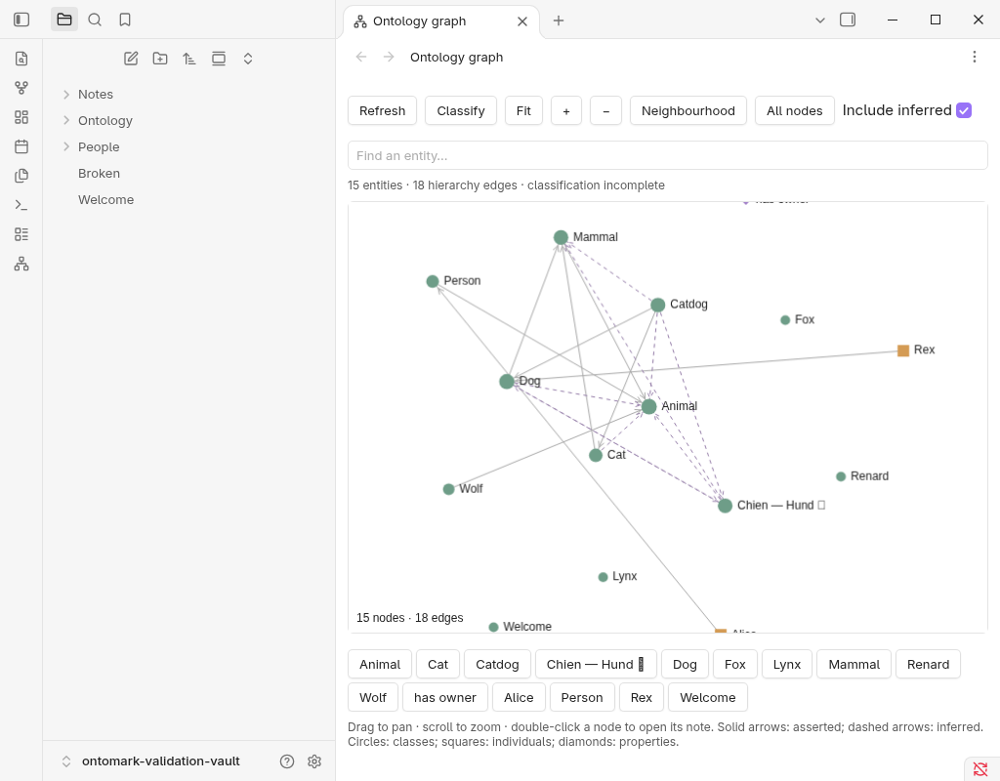
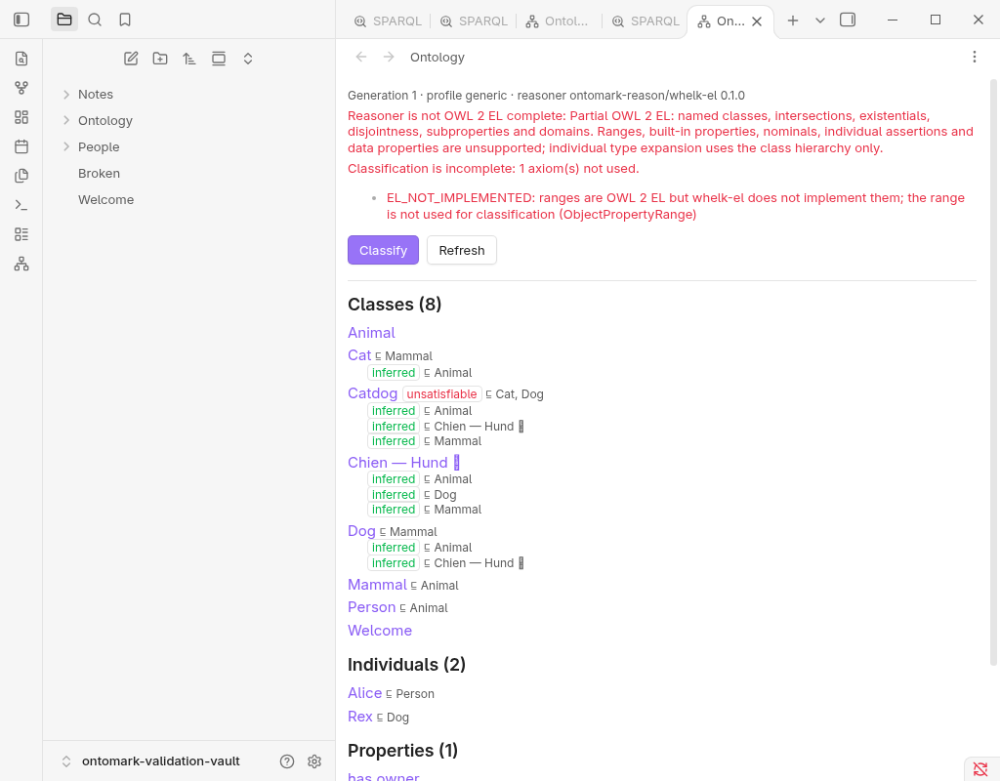
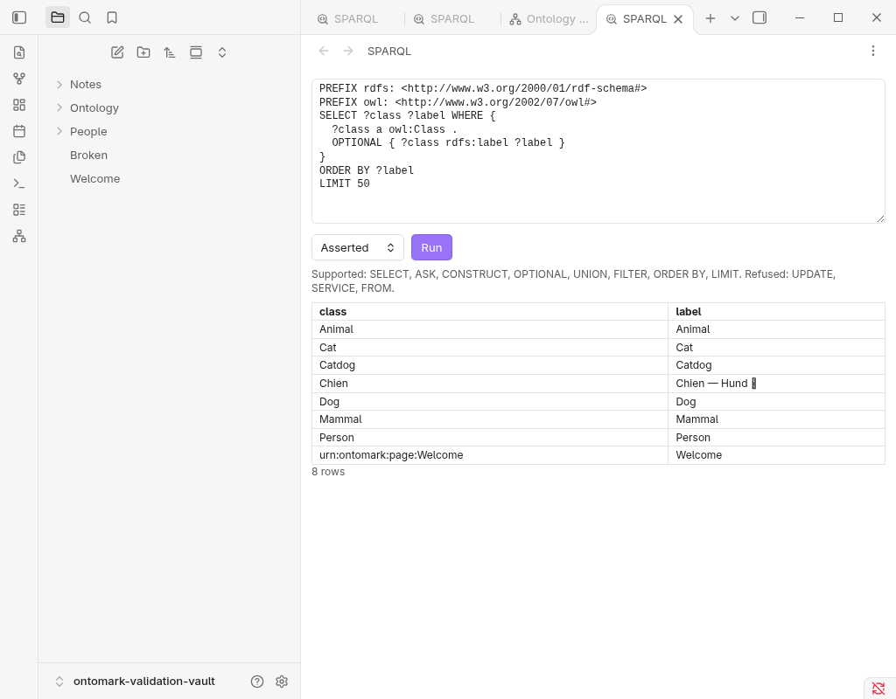

# Ontomark for Obsidian

**Give your Markdown notes a navigable, queryable layer of meaning.** Ontomark reads deliberate properties in Obsidian note frontmatter and turns them into an ontology: a description of the kinds of things in your vault and how they relate. Your notes remain ordinary Markdown files.

https://github.com/user-attachments/assets/5a129220-975a-4ac9-b501-d2b0365022cb

*Quick tour (2:09): graph, ontology panel, SPARQL queries, and reviewed edits. [Open the video issue](https://github.com/DreamLab-AI/ontomark-obsidian/issues/1).*

## Why add an ontology to a vault?

Obsidian links are excellent for moving between notes. An ontology adds **named kinds of things and explicit relationships** to those links. For example, a note about Rex can say that Rex is a Dog; Dog can say it is an Animal. Ontomark can then show the hierarchy and find Rex through those relationships without copying every ancestor into Rex's note.

This becomes useful when a vault grows beyond what backlinks can explain. You can distinguish “this note mentions a dog” from “this thing *is* a dog,” inspect the structure you have asserted, and spot relationships implied by it. Ordinary prose and wikilinks remain useful for reading and navigation; Ontomark treats only explicitly typed frontmatter as ontology statements.

The wider [VisionFlow](https://github.com/DreamLab-AI/VisionFlow) project aims to make human-readable Obsidian knowledge more useful for navigation and **context engineering**: selecting relevant, well-described context for LLMs and agents. Ontomark provides a local structural layer for that direction. This plugin does not itself call an LLM or send vault data to one.

## A small example

You can start with existing notes and add frontmatter as you go. No special folder layout is required.

`Animal.md`

```markdown
---
type: class
---
# Animal
Notes about animals can stay here.
```

`Dog.md`

```markdown
---
type: class
subclass-of: ["[[Animal]]"]
---
# Dog
Dogs are animals.
```

`Rex.md`

```markdown
---
type: individual
instance-of: ["[[Dog]]"]
---
# Rex
Rex is my dog.
```

Here **Animal** and **Dog** are *classes* (kinds of things), and **Rex** is an *individual* (a particular thing). `subclass-of` and `instance-of` give the links a precise meaning. A *property* names a relationship, such as `has-owner`, and can have its own note and hierarchy. Together these statements form a **knowledge graph**: things connected by named relationships.

Open **Ontology graph** from the command palette or ribbon to explore the hierarchy. Open **Ontology panel** to browse classes, individuals, properties, and diagnostics. Run **Classify now** to calculate relationships implied by the hierarchy; the graph draws inferred edges as dashed lines so you can distinguish them from what you wrote. Automatic classification is on by default and can be changed in settings.

## What the plugin adds

| Feature | What it does for your vault |
| --- | --- |
| **Ontology graph** | Explore typed notes and hierarchy links visually. Search, pan, zoom, focus on a neighbourhood, and open the underlying note. Solid edges are stated in frontmatter; dashed edges are inferred. |
| **Ontology panel** | Browse classes, individuals, and properties; see stated and inferred parents, unsatisfiable classes, and indexing or reasoning diagnostics. |
| **OWL reasoning** | Apply a supported part of **OWL** (Web Ontology Language) locally to derive class relationships. For example, if Dog is a Mammal and Mammal is an Animal, Dog is also an Animal. If a construct cannot be handled, Ontomark reports incomplete classification. |
| **SPARQL queries** | Ask structured questions of the local graph with **SPARQL** (pronounced “sparkle”), the query language for RDF knowledge graphs. Choose stated facts, inferred facts, or both; use SELECT for rows, ASK for yes/no, or CONSTRUCT for triples. The query view starts with a working class-list example. |
| **Reviewed edits** | Commands can make the active note a class, individual, or property, or add a parent. Each proposed frontmatter change appears as a diff and is written only after you press **Apply**. Ontomark refuses the write if the file changed after the preview. |

RDF is the subject–relationship–object format used for the queryable graph. You do not need to write RDF or SPARQL to use the visual views; Markdown frontmatter is the authoring surface.



<details>
<summary>See the ontology panel and SPARQL view</summary>





</details>

## Install

Ontomark currently supports **desktop Obsidian**.

1. Download [ontomark-obsidian-0.1.0.zip](https://github.com/DreamLab-AI/ontomark-obsidian/releases/download/0.1.0/ontomark-obsidian-0.1.0.zip) from the [0.1.0 release](https://github.com/DreamLab-AI/ontomark-obsidian/releases/tag/0.1.0).
2. Extract the ZIP into `<vault>/.obsidian/plugins/`. It creates an `ontomark` folder containing the plugin files.
3. In Obsidian, open **Settings → Community plugins**, enable Ontomark, and reload Obsidian if it was already open.

The release includes the engine, so runtime needs no Node, Rust, account, external database, or internet connection. Individual plugin files and a SHA-256 receipt are also on the release page.

## Frontmatter reference

Only notes with `type: class`, `type: individual`, or `type: property` become ontology entities. Other notes remain plain notes for navigation. Prose wikilinks do not become formal assertions.

| Key | Meaning |
| --- | --- |
| `type` | The note's ontology role: `class`, `individual`, or `property` |
| `title`, `aliases` | Display name and alternative labels |
| `iri` | Optional explicit identifier; otherwise derived from the note path |
| `subclass-of` / `is-a` | Parent class |
| `equivalent-to`, `disjoint-with` | Equivalent or mutually exclusive classes |
| `instance-of` | Class of an individual |
| `domain`, `range`, `subproperty-of` | Property description and hierarchy |

Other frontmatter keys are retained as annotations. In the Generic profile, you can use this model in any vault. The optional Estate corpus profile is described below.

<details>
<summary>How Ontomark fits into the wider VisionFlow estate</summary>

This repository is the Obsidian interface. The portable Rust and WebAssembly engine lives in [Ontomark](https://github.com/DreamLab-AI/ontomark), which also owns the reusable [graph renderer](https://github.com/DreamLab-AI/ontomark/tree/main/packages/graph). The plugin bundles the engine and renderer for offline use. The same graph package is used by Narrative Goldmine.

The optional **Estate corpus profile** (Settings → Ontomark → Profile) reads corpora that use resource IRIs, a `public: true` gate, `is-a`, and `same-as`. Keep the default **Generic** profile unless your vault follows that contract. [VisionFlow](https://github.com/DreamLab-AI/VisionFlow) is the broader project context; no other estate repository is required to install this plugin.

</details>

<details>
<summary>Where assisted ingestion fits today</summary>

Ontomark for Obsidian currently indexes **authored** frontmatter and offers small, reviewed edits. It does not extract entities from prose, convert documents, or auto-promote model output into your ontology.

The wider estate has a separate path for semi-automated work: [visionGraph](https://github.com/jjohare/visionGraph) holds the authored knowledge and working vaults; [agentbox](https://github.com/DreamLab-AI/agentbox) skills can research or extract candidate assertions (including a podcast transcript pipeline); the native Ontomark CLI can validate, build, and check estate-profile material; and [Loom](https://github.com/DreamLab-AI/loom) serves selected, reasoned context to models. Those are distinct tools with their own release and activation states, not an end-to-end ingest feature of this plugin.

An earlier [OntoCast adapter](https://github.com/DreamLab-AI/knowledgeGraph/blob/main/docs/integrations/ontocast.md) staged RDF as Markdown, but it emits retired Logseq syntax. [Our assisted-ingest ADR](docs/adr/ADR-OBS-002-assisted-ingest-boundary-and-estate-notes.md) records the proposed replacement: reusable Rust/WASM extraction in Ontomark, with a simple optional action over one vault in this plugin. It is not shipped yet. The ADR also maps the remaining work across the reorganisation sprint. Estate review and publication remain outside this plugin.

</details>

<details>
<summary>Current scope and technical limits</summary>

- Desktop only; mobile is not supported. Desktop acceptance was run in Obsidian 1.14.4 on Linux using a synthetic vault.
- Reasoning covers the implemented portion of OWL 2 EL. Unsupported constructs, including property ranges for reasoning, are reported and mark classification incomplete; they are not silently weakened. Individuals inherit types through the class hierarchy, but there is no broader individual-level (ABox) reasoning.
- Classification runs in a local background worker and discards stale results after edits. For a large vault that exceeds the complete-policy budget, it falls back to a relevant policy and reports that change. Deep class chains can be costly; there is no general size or latency guarantee.
- SPARQL supports SELECT, ASK, and CONSTRUCT with common graph patterns, joins, filters, grouping, ordering, and limits. UPDATE, SERVICE, FROM/FROM NAMED, DESCRIBE, and extension functions are refused. Queries have a time limit and a configurable row cap.
- The plugin makes no network requests. Its WebAssembly engine is embedded in `main.js` and executes locally.

The [desktop acceptance record](docs/desktop-acceptance.md) describes the tested scope. [Graph ownership](docs/adr/ADR-OBS-001-shared-graph.md) documents the boundary between the engine and this plugin.

</details>

<details>
<summary>Build and test from source</summary>

Node 22 or later is required. The build fetches the versioned Ontomark WebAssembly engine and verifies its pinned SHA-256; a Rust toolchain is not required. Install dev dependencies if your npm configuration omits them.

```sh
npm ci --include=dev
npm run build
npm run check:bundle
npm test
npm run test:wasm
npm run test:offline
```

`test:offline` installs the built plugin into a scratch vault and exercises indexing, classification, queries, reviewed edits, file events, and reload in a Docker container with `--network none`. It uses an Obsidian API stand-in; the separate [desktop acceptance](docs/desktop-acceptance.md) ran against installed Obsidian.

</details>

## Licence

MIT OR Apache-2.0. The release ZIP includes [third-party notices](THIRD-PARTY-NOTICES.md); [upstream credits](https://github.com/DreamLab-AI/ontomark/blob/main/docs/UPSTREAMS.md) cover the underlying components.
