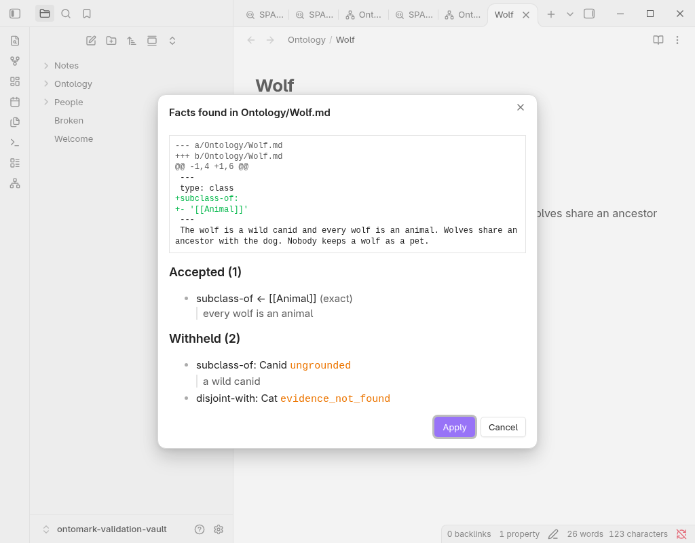

# Ontomark for Obsidian

**Make your vault mean something to a machine, without changing how you write.** Add a `type` and a parent link to a note's frontmatter and Ontomark turns your vault into an ontology: it draws the hierarchy, works out what follows from it, answers precise questions about it, and shows every proposed change as a diff before anything is written. Notes stay plain Markdown. Nothing leaves your computer unless you choose to connect a model.

https://github.com/user-attachments/assets/5a129220-975a-4ac9-b501-d2b0365022cb

*Quick tour (2:09): graph, ontology panel, SPARQL queries and reviewed edits. [Open the video issue](https://github.com/DreamLab-AI/ontomark-obsidian/issues/1).*

## Why bother?

Backlinks tell you two notes are related. They cannot tell you *how*. An ontology can: Rex **is a** Dog, Dog **is a kind of** Animal, so Rex is an Animal, and anyone, human or agent, asking "which animals are in this vault?" gets Rex without you ever writing that down.

That matters most when a vault grows past what you can hold in your head, and when you start pointing AI tools at it. A model reading prose sees words that happen to sit together. A model reading a typed graph gets facts it can follow, check and cite. Ontomark gives your vault that layer, locally.

## Three notes is enough to start

```markdown
# Animal.md
---
type: class
---
```

```markdown
# Dog.md
---
type: class
subclass-of: ["[[Animal]]"]
---
```

```markdown
# Rex.md
---
type: individual
instance-of: ["[[Dog]]"]
---
```

Open **Ontology graph**. Solid edges are what you wrote; the dashed `Rex → Animal` edge is what the reasoner worked out. No folder layout, no special syntax beyond three frontmatter keys.

## What you get

| | |
| --- | --- |
| **Ontology graph** | Explore typed notes and their hierarchy. Search, zoom, focus a neighbourhood, open the note. Inferred edges are dashed. |
| **Ontology panel** | Browse classes, individuals and properties; see stated and inferred parents, and anything the reasoner could not handle. |
| **Local reasoning** | An OWL 2 EL reasoner runs inside Obsidian and keeps up as you edit. Nothing is approximated: if a construct is unsupported, it says so. |
| **SPARQL** | Ask structured questions (SELECT, ASK, CONSTRUCT) over what you stated, what was inferred, or both. A working example is loaded for you. |
| **Reviewed edits** | Commands to make a note a class, individual or property, or add a parent. Every change is a diff you apply, and is refused if the file changed underneath it. |
| **Assisted ingest** | Point the plugin at a model endpoint of your choosing, enter a key for the session, and run *Extract facts from this note*. The model suggests; the engine checks every suggestion against your vault and the note's own text; you see a diff with each quote beside its fact, and the refusals with their reasons, and decide. Off by default: nothing is sent until you set an endpoint, and then only to that one URL, only when you run the command. |




<sup>Every count in the drawing comes from one six-note example vault (`docs/figures/anatomy-src/model.mjs`); the build fails if the drawing stops matching it. Ingest is drawn switched on; it is off by default and does nothing until you set an endpoint. The figure follows your system's light or dark setting.</sup>

### About assisted ingest

Language models are good at reading a note and bad at being trusted with your ontology: they invent identifiers, merge things that share a name, and quote text that is not there. Ontomark's ingest lets the model do only the reading.

- The model receives the note's text, its label and the keys it may fill. Never other notes, never your vault path, never your API key.
- The engine grounds every proposed **name** against the labels and aliases already in your vault; the model's own identifiers are ignored. A name that fits two notes is withheld as ambiguous, not guessed.
- Every value needs a verbatim quote from the note, and the quote has to mention the value. Literals are checked against their types (`3,5` is not a decimal; `2023-02-29` is not a date).
- Everything accepted becomes **one** patch, shown as the usual diff with the evidence highlighted. Everything refused is listed with the reason. Apply is the normal reviewed-edit path; undo is Obsidian's undo.

One endpoint, the one you type in, is the only place the plugin can send anything, and only when you run the command. Type the final URL: Obsidian's request layer follows redirects on its own, so the plugin refuses a 3xx answer rather than letting a hop choose the destination for you. [ADR-OBS-003](docs/adr/ADR-OBS-003-ingest-action-and-offline-contract.md) is the full decision.

## Why it works

A few numbers from the research this rests on:

- Asking a model questions over a **knowledge graph** instead of the raw database schema took GPT-4's accuracy on enterprise questions from **16% to 54%** (Sequeda, Allemang & Jacob, 2023, [arXiv:2311.07509](https://arxiv.org/abs/2311.07509)).
- Letting the model propose **names** and grounding them against a real vocabulary afterwards returned the correct ontology identifier for **98 of 100** terms; asking the model for identifiers directly got **3 of 100** (SPIRES, Caufield et al., *Bioinformatics* 2024, [arXiv:2304.02711](https://arxiv.org/abs/2304.02711)). That is the pattern Ontomark's ingest follows.
- Left to their own devices, models fabricate: **55%** of GPT-3.5's and **18%** of GPT-4's literature citations in one study did not exist (Walters & Wilder, *Scientific Reports* 2023, [doi:10.1038/s41598-023-41032-5](https://doi.org/10.1038/s41598-023-41032-5)). Hence a diff you review, not an edit you discover.
- The reasoning is cheap by design. **OWL 2 EL** keeps classification polynomial even with general axioms (Baader, Brandt & Lutz, IJCAI 2005), which is how an EL reasoner classifies SNOMED CT's ~300,000 concepts in **under ten seconds** (Kazakov, Krötzsch & Simančík, *J. Automated Reasoning* 2014). A vault is a great deal smaller.

Two things make the approach sound rather than hopeful. **OWL 2 EL** is the fragment of the Web Ontology Language built for large class hierarchies: classification is polynomial, which is why terminologies with hundreds of thousands of classes use it and why it can run inside an editor. And **grounding is a separate, deterministic step**: following the SPIRES pattern (Caufield et al., OntoGPT), the model proposes names and the engine resolves them against your real vocabulary, so a model error becomes a withheld suggestion rather than a wrong fact.

## Under the hood

Under the plugin sits [Ontomark](https://github.com/DreamLab-AI/ontomark), a Rust workspace (parser, typed model, `whelk-el` reasoner, RDF/SPARQL compiler, ingest) compiled to WebAssembly and embedded in the plugin, running in a background worker. The graph view is the shared [`ontomark-graph`](https://github.com/DreamLab-AI/ontomark/tree/main/packages/graph) package. The plugin itself is TypeScript, built with esbuild against the Obsidian API, and its release gate runs the built plugin in a Docker container with networking disabled and a tripwire on any socket, DNS or fetch.

**Limits worth knowing.** Desktop only for now. Reasoning covers the implemented part of OWL 2 EL (no property-range reasoning, no broader individual-level reasoning); unsupported constructs mark the result incomplete. Very large vaults fall back to a relevant-only classification policy and say so. SPARQL refuses UPDATE, SERVICE, FROM and DESCRIBE, and caps rows and time. Ingest proposes facts against the vocabulary you already have; it will not invent classes, and the guards decide what is *safe* to write, not what is *true*, which is why you review. Until you set an endpoint, the plugin makes no network requests at all; its release tests run it in a container with networking disabled.

## How it does on a real corpus

My own main vault is a public knowledge graph of **8,446 typed notes** (AI, governance, XR and more) kept to a stricter frontmatter spec, the VisionFlow corpus contract: every page has a stable resource IRI, `is-a` parents, a public gate and provenance. The plugin's optional **Estate corpus** profile reads that spec directly. Running the v0.2.0 engine the plugin ships over the whole vault, on an ordinary laptop (Intel i7-1165G7, 16 GB, Obsidian 1.14.4):

- all 8,446 notes indexed as entities, **278k triples in about 2 s**;
- full classification in **about 1.5 s**, complete, no unsatisfiable classes, about 58k subclass links in the combined graph;
- and real problems surfaced in the data: **935 ambiguous parent links** (a `[[Decentralized Autonomous Organization]]` that matches both *DAO* and the full-name note), **936 parents pointing at pages that do not exist**, and **42 accidental `is-a` cycles** that quietly make two classes one (*automation ≡ smart-home* was the author's favourite). Cleanup is in progress.

Ontomark's engine README reports the same corpus through its command-line build, which applies a different public gate and so counts 9,244 classes; the two figures measure different things, not a disagreement.

## Install

1. Download [ontomark-obsidian-0.2.0.zip](https://github.com/DreamLab-AI/ontomark-obsidian/releases/download/v0.2.0/ontomark-obsidian-0.2.0.zip) from the [0.2.0 release](https://github.com/DreamLab-AI/ontomark-obsidian/releases/tag/v0.2.0).
2. Extract it into `<vault>/.obsidian/plugins/`; it creates an `ontomark` folder.
3. **Settings → Community plugins**, enable Ontomark, reload if Obsidian was open.

Each release ships with the engine inside it: no Node, Rust, account, database or internet connection is needed.

## Frontmatter reference

Only notes with `type: class`, `type: individual` or `type: property` become ontology entities. Everything else stays a plain note. Prose wikilinks are never assertions.

| Key | Meaning |
| --- | --- |
| `type` | `class`, `individual` or `property` |
| `title`, `aliases` | Display name and other labels (also what ingest grounds against) |
| `iri` | Optional explicit identifier; otherwise derived from the note path |
| `subclass-of` / `is-a` | Parent class |
| `equivalent-to`, `disjoint-with` | Equivalent or mutually exclusive classes |
| `instance-of` | Class of an individual |
| `domain`, `range`, `subproperty-of` | Property description and hierarchy |

Other keys are kept as annotations. The default **Generic** profile works in any vault; the optional **Estate corpus** profile is for corpora that follow the VisionFlow contract.

## Further afield

This repository is only the Obsidian interface. If you want to go deeper:

- **[Ontomark](https://github.com/DreamLab-AI/ontomark)**: the engine, CLI, shared graph, and the measured case for structured knowledge made on a 9,000-note corpus.
- **[VisionFlow](https://github.com/DreamLab-AI/VisionFlow)**: the wider project on making human-written knowledge useful to agents.
- Local decisions: [ADR-OBS-001](docs/adr/ADR-OBS-001-shared-graph.md), [ADR-OBS-002](docs/adr/ADR-OBS-002-assisted-ingest-boundary-and-estate-notes.md), [ADR-OBS-003](docs/adr/ADR-OBS-003-ingest-action-and-offline-contract.md); [desktop acceptance record](docs/desktop-acceptance.md).

<details>
<summary>Build and test from source</summary>

Node 22 or later. The build fetches the pinned Ontomark engine and verifies its SHA-256; no Rust toolchain is required.

```sh
npm ci --include=dev
npm run build
npm run check:bundle
npm test
npm run test:wasm
npm run test:offline
```

</details>

## Licence

MIT OR Apache-2.0. The release ZIP includes [third-party notices](THIRD-PARTY-NOTICES.md); [upstream credits](https://github.com/DreamLab-AI/ontomark/blob/main/docs/UPSTREAMS.md) cover the engine's components.
